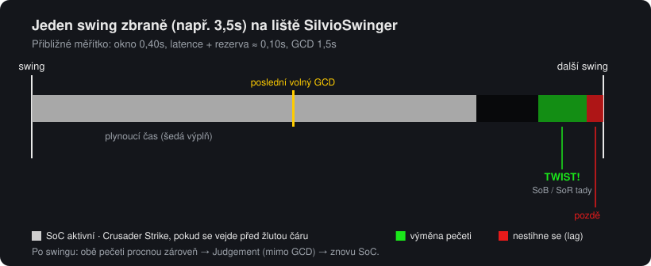
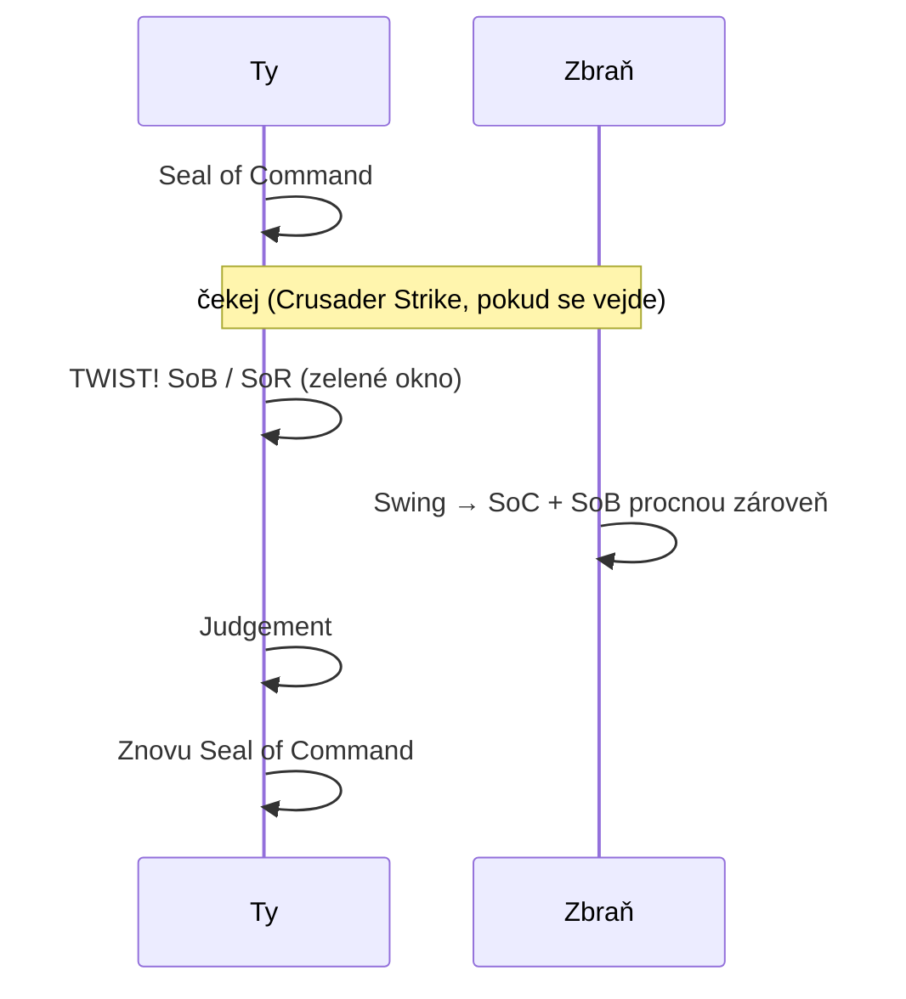
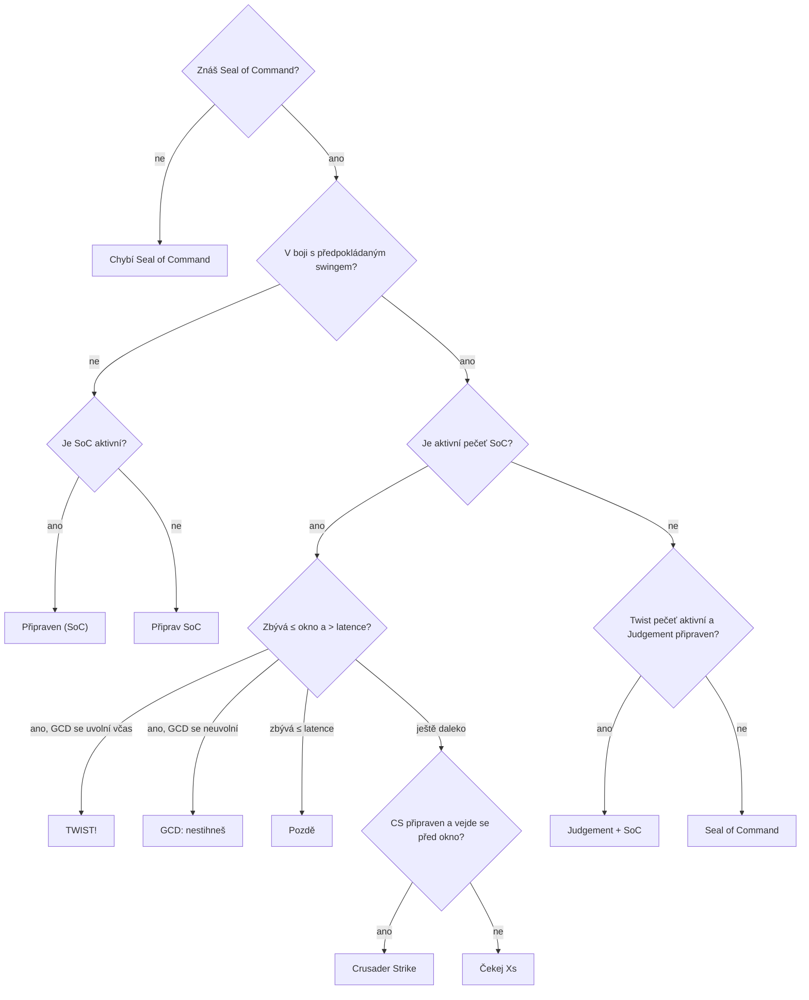
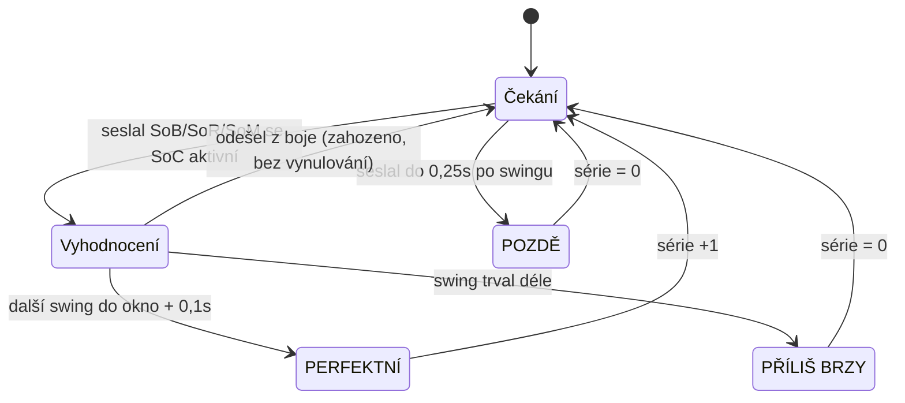

# SilvioSwinger

[English](README.md) · [Português (Brasil)](README.ptBR.md) · **Čeština** · [Deutsch](README.deDE.md) · [Español](README.esES.md) · [Français](README.frFR.md) · [Русский](README.ruRU.md)

Jednoduchý pomocník pro **seal twisting** pro Retribution Paladiny na klientu **2.4.3** (The Burning Crusade).

Zobrazuje swing timer s twist oknem, říká, které kouzlo zmáčknout teď a které přijde potom, měří poškození každého twistu a počítá, kolik twistů v řadě se ti povedlo (série).



## Co je seal twisting

Se zapnutou **Seal of Command (SoC)** přepneš během posledních ~0,4s před swingem na jinou pečeť (**Seal of Blood**, **Seal of Righteousness** nebo **Seal of the Martyr**). Swing, který dopadne hned potom, spustí **obě pečeti**. Pak použiješ Judgement (nezávisí na GCD) a nahodíš znovu SoC na další swing.



## Instalace

1. Zkopíruj složku `SilvioSwinger` do `World of Warcraft/Interface/AddOns/`.
2. Přihlas se za Paladina. U jiných povolání se addon sám skryje.
3. Okno přesuneš tak, že podržíš **Shift** a táhneš.
4. Pro češtinu vyber **Čeština** v nabídce **Jazyk** v panelu nebo použij `/silvio lang csCZ`. Český klient 2.4.3 neexistuje, takže výchozí je angličtina.

## Okno

```
 [ikona teď] [další]  TWIST!
                      MÁLO MANY  lat 85ms
 [████████████████░░░░░░░|░░░░░░░░░░▓▓▓▓█]  1.23 / 3.50
 Série 4 (nejlepší 9)  průměr 2310            PERFEKTNÍ
```

| Prvek | Význam |
|---|---|
| Velká ikona | Co zmáčknout **teď** (svítí, když je čas) |
| Malá ikona | Co přijde **potom** |
| Text | Pokyn: `Připrav SoC`, `Crusader Strike`, `Čekej 1.2s`, `TWIST!`, `Judgement + SoC`, `GCD: nestihneš`, `Pozdě` |
| `lat` | Aktuální latence + rezerva. Pod nastaveným limitem se zobrazí `MÁLO MANY` |
| Šedá lišta | Čas do dalšího swingu (zbývá / rychlost zbraně) |
| Žlutá čára | Poslední chvíle pro GCD (SoC/CS), aniž bys přišel o twist |
| Zelená zóna | Twist okno: tady vyměň pečeť |
| Červená zóna | Latence: pečeť použitá tady dorazí až po swingu |
| Série / výsledek | Viz [Série](#série) |

Pokud je zbraň příliš rychlá na SoC + twist v jednom swingu, žlutá čára zmizí.

## Jak se rozhoduje, co doporučit



Twist pečeť se vybírá ze spellbooku v tomto pořadí: Seal of Blood, Seal of the Martyr a Seal of Righteousness. Všechny názvy se berou ze spell ID, takže addon funguje v jakémkoli jazyce klienta.

Změny haste (Bloodlust, Drums, Haste Potion) přepočítají probíhající swing. Kouzla s časem sesílání (Exorcism, Flash of Light) timer restartují. Extra útoky (Windfury, Hand of Justice) ne.

## Série

Série počítá, kolik **správně načasovaných twistů** jsi udělal za sebou.



- Pokus existuje jen tehdy, když použiješ twist pečeť a SoC byla aktivní během posledních 0,3s.
- Swingy bez pokusu sérii nepřeruší.
- Změna cíle ani odchod z boje sérii nevynuluje.
- Swing, který mine (miss/dodge), se také počítá jako swing.
- `série` a `nejlepší` **se neukládají**. Vynulují se po `/reload`, při odhlášení, přes `/silvio reset` nebo tlačítkem v panelu.

## Poškození twistu

Všechno, co dopadne se swingem do 0,4s (bílý hit, extra útoky a procy pečetí), jde do jednoho „balíčku“. Pokud procly dvě pečeti zároveň nebo byl twist správně načasovaný, součet se zobrazí nahoře na obrazovce:

```
TWIST POŠKOZENÍ: 2480  (hit 1320 + SoC 690 + SoB 470)
```

Poškození, které Seal of Blood způsobí tobě, se ignoruje.

## Příkazy

`/silvio` nebo `/ss`

| Příkaz | Účinek |
|---|---|
| `/silvio` | Ukáže aktuální stav a seznam příkazů |
| `/silvio config` | Otevře panel (ESC > Interface > AddOns > SilvioSwinger) |
| `/silvio lock` / `unlock` | Zamkne nebo odemkne pozici |
| `/silvio window <s>` | Velikost twist okna |
| `/silvio buffer <s>` | Extra rezerva přičtená k latenci |
| `/silvio cs <s>` | Rezerva potřebná pro Crusader Strike |
| `/silvio scale <n>` | Velikost okna |
| `/silvio judge` | Zapne/vypne doporučení Judgementu |
| `/silvio sound` | Zapne/vypne zvuk při otevření okna (při zapnutí přehraje ukázku) |
| `/silvio msg` | Zapne/vypne `TWIST POŠKOZENÍ` nahoře |
| `/silvio detail` | Zapne/vypne rozpis poškození |
| `/silvio dmg` | Ukáže statistiky poškození |
| `/silvio dmgreset` | Vynuluje statistiky poškození |
| `/silvio show` / `hide` | Ukáže nebo skryje okno (logika běží dál) |
| `/silvio lang <kód>` | Změní jazyk (`auto`, `enUS`, `ptBR`, `csCZ`...) |
| `/silvio reset` | Vynuluje sérii a vrátí okno na místo |

## Nastavení

Ukládá se do `SilvioSwingerDB`.

| Volba | Výchozí | Popis |
|---|---|---|
| `window` | 0,40s | Jak dlouho před swingem twist ještě funguje |
| `buffer` | 0,05s | Rezerva přičtená k latenci |
| `csSlack` | 0,10s | Rezerva pro Crusader Strike před oknem |
| `judge` | zapnuto | Doporučit Judgement po twistu |
| `sound` | zapnuto | Ping minimapy při otevření twist okna, jednou za swing |
| `lowMana` | 10% | Hranice varování o nízké maně |
| `dmgMsg` | zapnuto | Zpráva `TWIST POŠKOZENÍ` |
| `breakdown` | zapnuto | Rozepsat hit + pečeti ve zprávě |
| `scale` | 1,0 | Velikost okna |
| `locale` | `auto` | Jazyk rozhraní (`auto` = jazyk klienta) |

## Jazyky

Ve výchozím stavu addon používá jazyk klienta (`GetLocale()`). Změníš ho v nabídce **Jazyk** v panelu nebo přes `/silvio lang <kód>`. Změna platí hned, bez `/reload`.

| Kód | Jazyk | Poznámka |
|---|---|---|
| `enUS` | English | Základní jazyk. Používá ho i klient `enGB` a každý klient bez překladu |
| `ptBR` | Português (Brasil) | Klient ptBR 2.4.3 neexistuje: zapni v panelu |
| `csCZ` | Čeština | Klient csCZ 2.4.3 neexistuje: zapni v panelu |
| `deDE` | Deutsch | |
| `esES` | Español | Používá ho i klient `esMX` |
| `frFR` | Français | |
| `ruRU` | Русский | Na neruském klientu výchozí font nemá azbuku a text může zmizet |

Názvy kouzel (Crusader Strike, Seal of Command...) dál pochází z klienta, protože se čtou přes spell ID.

Pokud se nějaké písmeno zobrazí jako čtvereček nebo zmizí (třeba `ř` nebo `ě`), font klienta tento znak nemá.

### Přidání jazyka

1. Zkopíruj `Locales/enUS.lua` do `Locales/<kód>.lua` (např. `plPL.lua`).
2. Nahraď `SilvioSwingerLocales.enUS` za `SilvioSwingerLocales.<kód>`, uprav `_name` a přelož texty. Zachovej `%d`, `%s` a `%.1f` ve stejném pořadí.
3. Přidej `Locales\<kód>.lua` do `SilvioSwinger.toc`, před `SilvioSwinger.lua`.
4. Volitelně vytvoř `README.<kód>.md` a přidej odkaz do jazykové lišty nahoře ve všech README.

Text, který v překladu chybí, se zobrazí anglicky.
