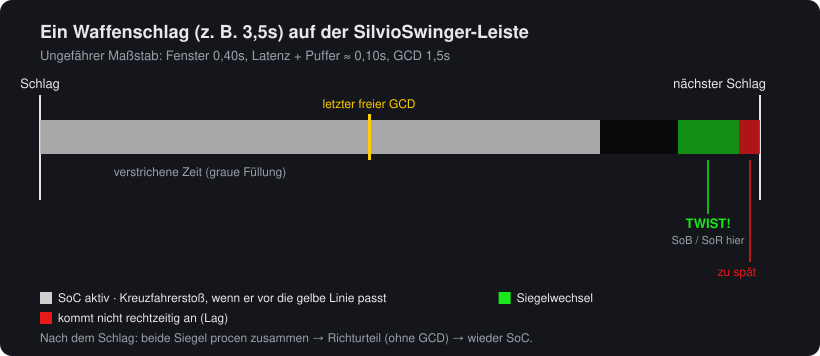
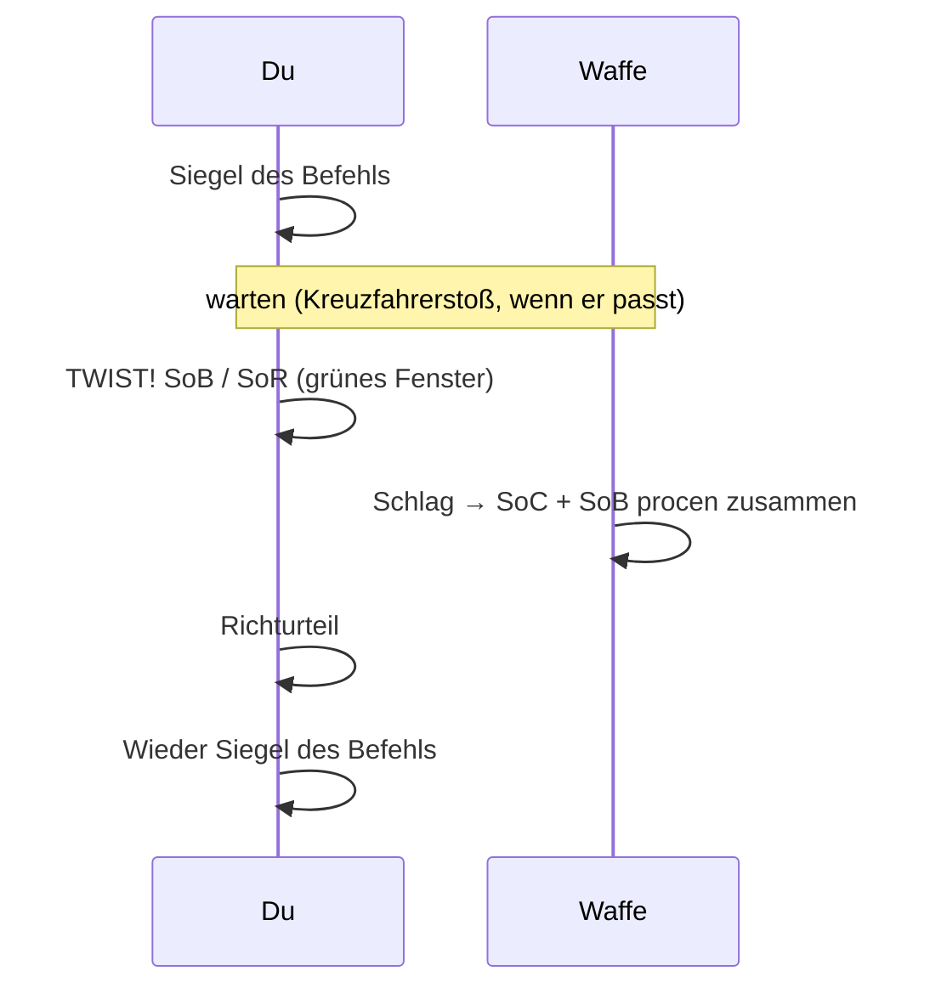
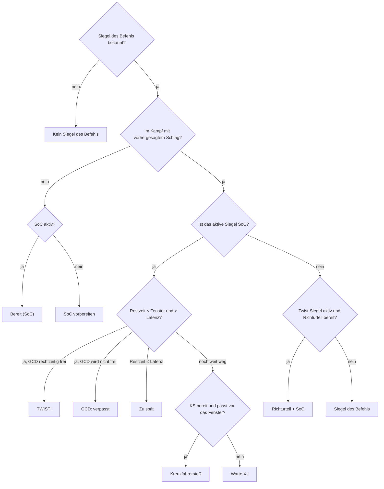
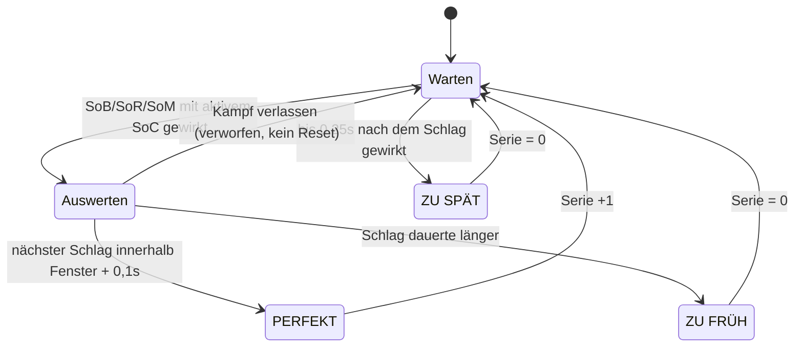

# SilvioSwinger

[English](README.md) · [Português (Brasil)](README.ptBR.md) · [Čeština](README.csCZ.md) · **Deutsch** · [Español](README.esES.md) · [Français](README.frFR.md) · [Русский](README.ruRU.md)

Ein einfacher Helfer für **Seal Twisting** für Vergeltungspaladine auf dem **2.4.3**-Client (The Burning Crusade).

Er zeigt einen Swing-Timer mit dem Twist-Fenster, sagt dir, welchen Zauber du jetzt drücken sollst und welcher als Nächstes kommt, misst den Schaden jedes Twists und zählt, wie viele Twists in Folge dir gelungen sind (Serie).



## Was Seal Twisting ist

Mit aktivem **Siegel des Befehls (SoC)** wechselst du in den letzten ~0,4s vor dem Schlag zu einem anderen Siegel (**Siegel des Blutes**, **Siegel der Rechtschaffenheit** oder **Siegel des Märtyrers**). Der Schlag, der direkt danach trifft, löst **beide Siegel** aus. Danach setzt du Richturteil ein (hängt nicht vom GCD ab) und legst SoC für den nächsten Schlag wieder an.



## Installation

1. Lade `SilvioSwinger-X.Y.Z.zip` aus dem [neuesten Release](https://github.com/SilvioDoMine/Silvio-Swinger-WoW-Addon/releases/latest) herunter und entpacke es nach `World of Warcraft/Interface/AddOns/`. Der Ordner `SilvioSwinger` ist schon enthalten.
2. Logge dich mit einem Paladin ein. Bei anderen Klassen blendet sich das Addon selbst aus.
3. Um das Fenster zu verschieben, halte **Shift** gedrückt und ziehe.

## Das Fenster

```
 [Symbol jetzt] [nächstes]  TWIST!
                            WENIG MANA  Lat. 85ms
 [████████████████░░░░░░░|░░░░░░░░░░▓▓▓▓█]  1.23 / 3.50
 Serie 4 (beste 9)  Ø 2310                    PERFEKT
```

| Element | Bedeutung |
|---|---|
| Großes Symbol | Was du **jetzt** drücken sollst (leuchtet, wenn es Zeit ist) |
| Kleines Symbol | Was als **Nächstes** kommt |
| Text | Anweisung: `SoC vorbereiten`, Kreuzfahrerstoß, `Warte 1.2s`, `TWIST!`, `Richturteil + SoC`, `GCD: verpasst`, `Zu spät` |
| `Lat.` | Aktuelle Latenz + Puffer. Unter dem eingestellten Grenzwert erscheint `WENIG MANA` |
| Graue Leiste | Zeit bis zum nächsten Schlag (verbleibend / Waffengeschwindigkeit) |
| Gelbe Linie | Letzter Moment für den GCD (SoC/KS), ohne den Twist zu verlieren |
| Grüne Zone | Twist-Fenster: hier das Siegel wechseln |
| Rote Zone | Latenz: ein hier eingesetztes Siegel kommt erst nach dem Schlag an |
| Serie / Ergebnis | Siehe [Serie](#serie) |

Ist die Waffe zu schnell, um SoC + Twist im selben Schlag unterzubringen, verschwindet die gelbe Linie.

## Wie es entscheidet, was empfohlen wird



Das Twist-Siegel wird in dieser Reihenfolge aus dem Zauberbuch gewählt: Siegel des Blutes, Siegel des Märtyrers und Siegel der Rechtschaffenheit. Alle Namen kommen aus der Spell-ID, daher funktioniert das Addon in jeder Client-Sprache.

Tempoänderungen (Kampfrausch, Trommeln, Hasttrank) skalieren den laufenden Schlag neu. Zauber mit Zauberzeit (Exorzismus, Lichtblitz) starten den Timer neu. Extraangriffe (Windzorn, Hand der Gerechtigkeit) nicht.

## Serie

Die Serie zählt, wie viele **richtig getimte Twists** du hintereinander geschafft hast.



- Ein Versuch zählt nur, wenn das Twist-Siegel eingesetzt wird und SoC in den letzten 0,3s aktiv war.
- Schläge ohne Versuch unterbrechen die Serie nicht.
- Zielwechsel oder das Verlassen des Kampfes setzen die Serie nicht zurück.
- Ein Schlag, der verfehlt (Verfehlen/Ausweichen), zählt trotzdem als Schlag.
- `Serie` und `beste` **werden nicht gespeichert**. Sie werden bei `/reload`, beim Ausloggen, mit `/silvio reset` oder über den Button im Fenster zurückgesetzt.

## Twist-Schaden

Alles, was innerhalb von 0,4s mit dem Schlag trifft (weißer Treffer, Extraangriffe und Siegel-Procs), landet in einem „Paket“. Wenn zwei Siegel zusammen geproct haben oder der Twist richtig getimt war, erscheint die Summe oben am Bildschirm:

```
TWIST-SCHADEN: 3770  =  Treffer 1320 (1) + Windfury Attack 600 (1) + SoC 1380 (2) + SoB 470 (1)
```

Die Zahl in Klammern gibt an, wie viele Treffer oder Procs von jedem gelandet sind. Extraangriffe (Abrechnung, Totem des Windzorns, Hand der Gerechtigkeit...) werden einzeln aufgeführt, mit dem Namen, den dein Client ihnen gibt. So siehst du leicht, wenn etwas nicht synchron ist: Fehlt `SoB`, kam der Siegelwechsel erst nach dem Schlag an. `SoB (2)` bei nur einem Treffer ist normal: Der Proc des Siegels des Befehls kann auch das Siegel des Blutes auslösen, daher bringt ein guter Twist oft ein zusätzliches SoB. Mit `/silvio debug` siehst du jedes Ereignis und wie es gezählt wurde.

Schaden, den das Siegel des Blutes dir selbst zufügt, wird ignoriert.

## Befehle

`/silvio` oder `/ss`

| Befehl | Wirkung |
|---|---|
| `/silvio` | Zeigt den aktuellen Status und die Befehlsliste |
| `/silvio config` | Öffnet das Fenster (ESC > Interface > AddOns > SilvioSwinger) |
| `/silvio lock` / `unlock` | Sperrt oder entsperrt die Position |
| `/silvio window <s>` | Größe des Twist-Fensters |
| `/silvio buffer <s>` | Zusätzlicher Puffer zur Latenz |
| `/silvio cs <s>` | Nötiger Spielraum für einen Kreuzfahrerstoß |
| `/silvio scale <n>` | Fenstergröße |
| `/silvio judge` | Schaltet den Richturteil-Vorschlag an/aus |
| `/silvio sound` | Schaltet den Ton beim Öffnen des Fensters an/aus (beim Einschalten eine Vorschau) |
| `/silvio msg` | Schaltet `TWIST-SCHADEN` oben an/aus |
| `/silvio detail` | Schaltet die Schadensaufschlüsselung an/aus |
| `/silvio dmg` | Zeigt die Schadensstatistik |
| `/silvio dmgreset` | Setzt die Schadensstatistik zurück |
| `/silvio show` / `hide` | Zeigt oder versteckt das Fenster (die Logik läuft weiter) |
| `/silvio lang <Code>` | Ändert die Sprache (`auto`, `enUS`, `deDE`, `ptBR`...) |
| `/silvio debug` | Diagnosemodus: schreibt jedes Kampflog-Ereignis des Twists in den Chat und wie es gezählt wurde (bis zum `/reload`) |
| `/silvio reset` | Setzt die Serie zurück und positioniert das Fenster neu |

## Einstellungen

Gespeichert in `SilvioSwingerDB`.

| Option | Standard | Beschreibung |
|---|---|---|
| `window` | 0,40s | Wie lange vor dem Schlag der Twist noch funktioniert |
| `buffer` | 0,05s | Puffer, der zur Latenz addiert wird |
| `csSlack` | 0,10s | Spielraum für einen Kreuzfahrerstoß vor dem Fenster |
| `judge` | an | Richturteil nach dem Twist vorschlagen |
| `sound` | an | Minimap-Ping beim Öffnen des Twist-Fensters, einmal pro Schlag |
| `lowMana` | 10% | Grenzwert der Warnung bei wenig Mana |
| `dmgMsg` | an | Meldung `TWIST-SCHADEN` |
| `breakdown` | an | Treffer + Siegel in der Meldung aufschlüsseln |
| `scale` | 1,0 | Fenstergröße |
| `locale` | `auto` | Sprache der Oberfläche (`auto` = Client-Sprache) |

## Sprachen

Standardmäßig nutzt das Addon die Client-Sprache (`GetLocale()`). Zum Ändern nutze das Menü **Sprache** im Fenster oder `/silvio lang <Code>`. Die Änderung gilt sofort, ohne `/reload`.

| Code | Sprache | Hinweis |
|---|---|---|
| `enUS` | English | Basissprache. Wird auch vom `enGB`-Client und jedem Client ohne Übersetzung genutzt |
| `ptBR` | Português (Brasil) | Es gibt keinen ptBR-Client für 2.4.3: im Fenster aktivieren |
| `csCZ` | Čeština | Es gibt keinen csCZ-Client für 2.4.3: im Fenster aktivieren |
| `deDE` | Deutsch | |
| `esES` | Español | Wird auch vom `esMX`-Client genutzt |
| `frFR` | Français | |
| `ruRU` | Русский | Auf einem nicht-russischen Client hat die Standardschrift kein Kyrillisch und der Text kann verschwinden |

Zaubernamen (Kreuzfahrerstoß, Siegel des Befehls...) kommen weiterhin vom Client, weil sie über die Spell-ID gelesen werden.

Wenn ein Buchstabe als Kästchen erscheint oder verschwindet (zum Beispiel tschechisches `ř` oder `ě`), fehlt dieses Zeichen in der Client-Schrift.

### Eine Sprache hinzufügen

1. Kopiere `Locales/enUS.lua` nach `Locales/<Code>.lua` (z. B. `plPL.lua`).
2. Ersetze `SilvioSwingerLocales.enUS` durch `SilvioSwingerLocales.<Code>`, passe `_name` an und übersetze die Texte. Behalte `%d`, `%s` und `%.1f` in derselben Reihenfolge.
3. Füge `Locales\<Code>.lua` in `SilvioSwinger.toc` vor `SilvioSwinger.lua` ein.
4. Optional: lege eine `README.<Code>.md` an und verlinke sie in der Sprachleiste oben in allen READMEs.

Fehlt ein Text in einer Übersetzung, erscheint er auf Englisch.
