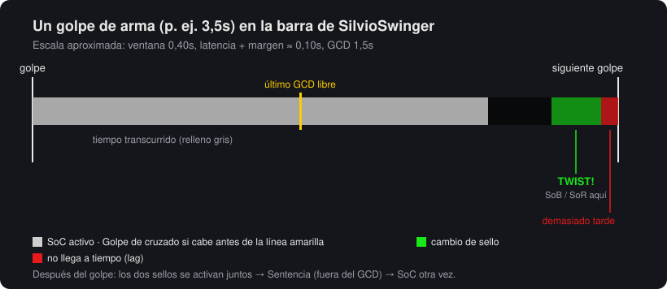
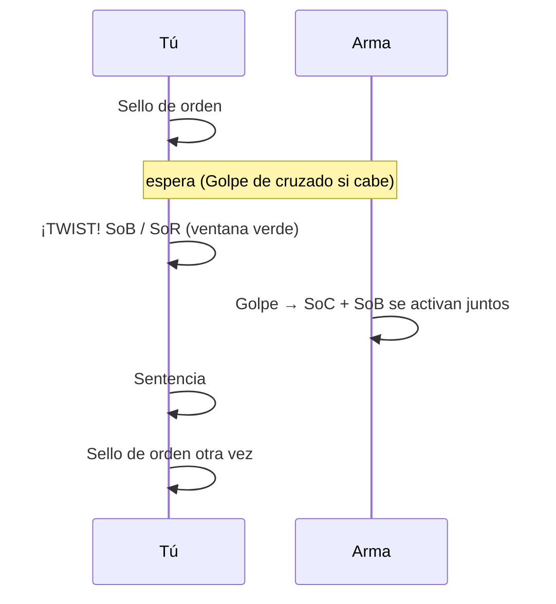
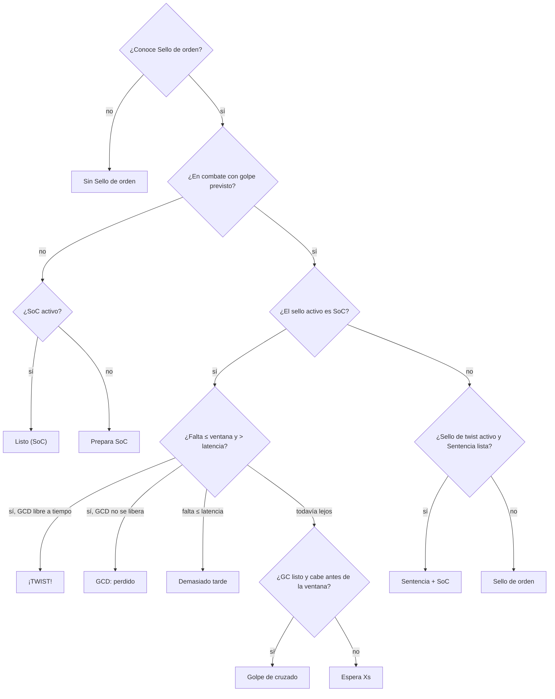
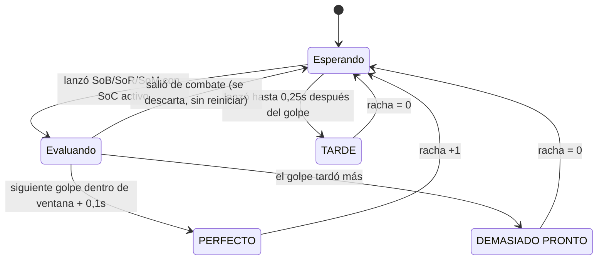

# SilvioSwinger

[English](README.md) · [Português (Brasil)](README.ptBR.md) · [Čeština](README.csCZ.md) · [Deutsch](README.deDE.md) · **Español** · [Français](README.frFR.md) · [Русский](README.ruRU.md)

Un indicador sencillo de **seal twisting** para Paladín Reprensión en el cliente **2.4.3** (The Burning Crusade).

Muestra un swing timer con la ventana de twist, te dice qué hechizo pulsar ahora y cuál viene después, mide el daño de cada twist y cuenta cuántos twists seguidos has acertado (racha).



## Qué es el seal twisting

Con el **Sello de orden (SoC)** activo, cambias a otro sello (**Sello de sangre**, **Sello de rectitud** o **Sello del mártir**) en los últimos ~0,4s antes del golpe. El golpe que cae justo después activa **los dos sellos**. Luego usas Sentencia (que no depende del GCD) y vuelves a poner SoC para el siguiente golpe.



## Instalación

1. Descarga `SilvioSwinger-X.Y.Z.zip` de la [última versión](https://github.com/SilvioDoMine/Silvio-Swinger-WoW-Addon/releases/latest) y descomprímelo en `World of Warcraft/Interface/AddOns/`. Ya incluye la carpeta `SilvioSwinger`.
2. Entra al juego con un Paladín. En otras clases el addon se oculta solo.
3. Para mover la ventana, mantén **Shift** y arrastra.

## La ventana

```
 [icono ahora] [siguiente]  ¡TWIST!
                            MANÁ BAJO  lat 85ms
 [████████████████░░░░░░░|░░░░░░░░░░▓▓▓▓█]  1.23 / 3.50
 Racha 4 (mejor 9)  media 2310                PERFECTO
```

| Elemento | Significado |
|---|---|
| Icono grande | Qué pulsar **ahora** (brilla cuando es el momento) |
| Icono pequeño | Qué viene **después** |
| Texto | Instrucción: `Prepara SoC`, Golpe de cruzado, `Espera 1.2s`, `¡TWIST!`, `Sentencia + SoC`, `GCD: perdido`, `Demasiado tarde` |
| `lat` | Latencia actual + margen. Aparece `MANÁ BAJO` por debajo del límite configurado |
| Barra gris | Tiempo hasta el siguiente golpe (restante / velocidad del arma) |
| Línea amarilla | Último momento para usar el GCD (SoC/GC) sin perder el twist |
| Zona verde | Ventana de twist: cambia el sello aquí |
| Zona roja | Latencia: un sello usado aquí llega después del golpe |
| Racha / resultado | Ver [Racha](#racha) |

Si el arma es demasiado rápida para que quepan SoC + twist en el mismo golpe, la línea amarilla desaparece.

## Cómo decide qué recomendar



El sello de twist se elige del libro de hechizos en este orden: Sello de sangre, Sello del mártir y Sello de rectitud. Todos los nombres salen del ID del hechizo, así que el addon funciona en cualquier idioma del cliente.

Los cambios de celeridad (Ansia de sangre, Tambores, Poción de celeridad) reescalan el golpe en curso. Los hechizos con tiempo de lanzamiento (Exorcismo, Destello de Luz) reinician el temporizador. Los ataques extra (Viento furioso, Mano de justicia) no.

## Racha

La racha cuenta cuántos **twists bien sincronizados** has hecho seguidos.



- Solo hay intento cuando el sello de twist se usa con SoC activo en los últimos 0,3s.
- Los golpes sin intento no rompen la racha.
- Cambiar de objetivo o salir de combate no reinicia la racha.
- Un golpe que falla (fallo/esquiva) también cuenta como golpe.
- `racha` y `mejor` **no se guardan**. Se reinician con `/reload`, al cerrar sesión, con `/silvio reset` o con el botón del panel.

## Daño del twist

Todo lo que cae junto con el golpe en 0,4s (golpe blanco, ataques extra y activaciones de sello) entra en un mismo "paquete". Si dos sellos se activaron juntos, o si el twist estuvo bien sincronizado, el total aparece arriba en la pantalla:

```
DAÑO DEL TWIST: 3770  =  golpe 1320 (1) + Windfury Attack 600 (1) + SoC 1380 (2) + SoB 470 (1)
```

El número entre paréntesis es cuántos golpes o activaciones de cada uno cayeron. Los ataques extra (Represalia, Tótem Viento Furioso, Mano de justicia...) aparecen por separado, con el nombre que les da tu cliente. Así es fácil ver cuándo algo está desincronizado: si falta `SoB`, el cambio de sello llegó después del golpe. `SoB (2)` con un solo golpe es normal: la activación del Sello de orden también puede activar el Sello de sangre, así que un buen twist a menudo da un SoB extra. Usa `/silvio debug` para ver cada evento y cómo se contó.

Se ignora el daño que el Sello de sangre te hace a ti mismo.

## Comandos

`/silvio` o `/ss`

| Comando | Efecto |
|---|---|
| `/silvio` | Muestra el estado actual y la lista de comandos |
| `/silvio config` | Abre el panel (ESC > Interface > AddOns > SilvioSwinger) |
| `/silvio lock` / `unlock` | Bloquea o desbloquea la posición |
| `/silvio window <s>` | Tamaño de la ventana de twist |
| `/silvio buffer <s>` | Margen extra sumado a la latencia |
| `/silvio cs <s>` | Holgura necesaria para meter un Golpe de cruzado |
| `/silvio scale <n>` | Escala de la ventana |
| `/silvio judge` | Activa/desactiva la sugerencia de Sentencia |
| `/silvio sound` | Activa/desactiva el sonido al abrirse la ventana (al activarlo, reproduce una muestra) |
| `/silvio msg` | Activa/desactiva `DAÑO DEL TWIST` arriba |
| `/silvio detail` | Activa/desactiva el detalle del daño |
| `/silvio dmg` | Muestra las estadísticas de daño |
| `/silvio dmgreset` | Reinicia las estadísticas de daño |
| `/silvio show` / `hide` | Muestra u oculta la ventana (la lógica sigue funcionando) |
| `/silvio lang <código>` | Cambia el idioma (`auto`, `enUS`, `esES`, `ptBR`...) |
| `/silvio debug` | Modo diagnóstico: escribe en el chat cada evento del registro de combate del twist y cómo se contó (hasta el `/reload`) |
| `/silvio reset` | Reinicia la racha y recoloca la ventana |

## Configuración

Se guarda en `SilvioSwingerDB`.

| Opción | Por defecto | Descripción |
|---|---|---|
| `window` | 0,40s | Cuánto antes del golpe sigue funcionando el twist |
| `buffer` | 0,05s | Margen sumado a la latencia |
| `csSlack` | 0,10s | Holgura para meter un Golpe de cruzado antes de la ventana |
| `judge` | activado | Sugerir Sentencia después del twist |
| `sound` | activado | Ping del minimapa al abrirse la ventana de twist, una vez por golpe |
| `lowMana` | 10% | Límite del aviso de maná bajo |
| `dmgMsg` | activado | Mensaje `DAÑO DEL TWIST` |
| `breakdown` | activado | Detallar golpe + sellos en el mensaje |
| `scale` | 1,0 | Escala de la ventana |
| `locale` | `auto` | Idioma de la interfaz (`auto` = idioma del cliente) |

## Idiomas

Por defecto el addon usa el idioma del cliente (`GetLocale()`). Para cambiarlo, usa el menú **Idioma** del panel o `/silvio lang <código>`. El cambio se aplica al instante, sin `/reload`.

| Código | Idioma | Nota |
|---|---|---|
| `enUS` | English | Idioma base. También lo usa el cliente `enGB` y cualquier cliente sin traducción |
| `ptBR` | Português (Brasil) | No existe cliente ptBR de 2.4.3: actívalo en el panel |
| `csCZ` | Čeština | No existe cliente csCZ de 2.4.3: actívalo en el panel |
| `deDE` | Deutsch | |
| `esES` | Español | También lo usa el cliente `esMX` |
| `frFR` | Français | |
| `ruRU` | Русский | En un cliente que no es ruso, la fuente por defecto no tiene cirílico y el texto puede desaparecer |

Los nombres de los hechizos (Golpe de cruzado, Sello de orden...) siguen viniendo del cliente, porque se leen por ID de hechizo.

Si alguna letra aparece como un cuadrado o desaparece (por ejemplo la `ř` o la `ě` del checo), la fuente del cliente no tiene ese carácter.

### Añadir un idioma

1. Copia `Locales/enUS.lua` a `Locales/<código>.lua` (p. ej. `plPL.lua`).
2. Cambia `SilvioSwingerLocales.enUS` por `SilvioSwingerLocales.<código>`, ajusta `_name` y traduce los textos. Mantén `%d`, `%s` y `%.1f` en el mismo orden.
3. Añade `Locales\<código>.lua` en `SilvioSwinger.toc`, antes de `SilvioSwinger.lua`.
4. Si quieres, crea un `README.<código>.md` y enlázalo en la barra de idiomas al principio de todos los README.

Un texto que falte en la traducción aparece en inglés.
