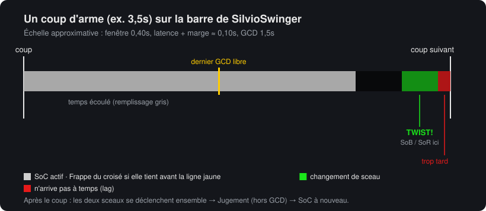
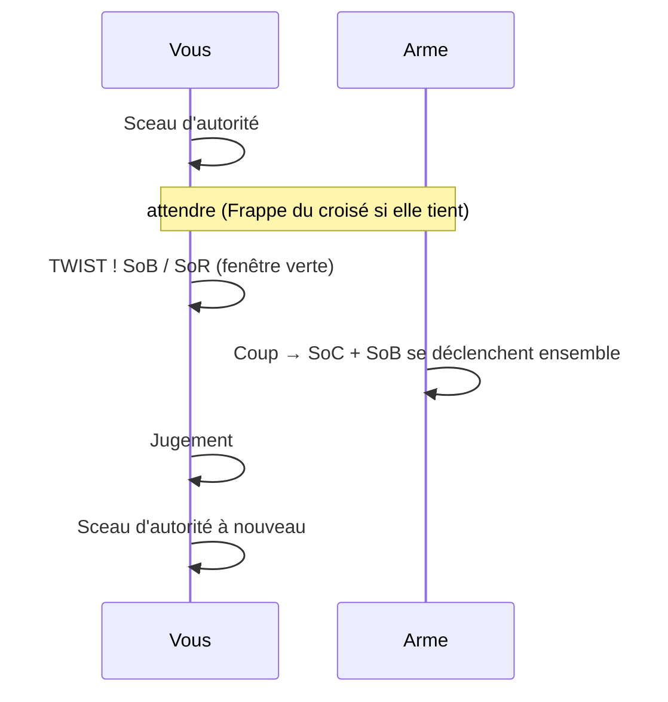
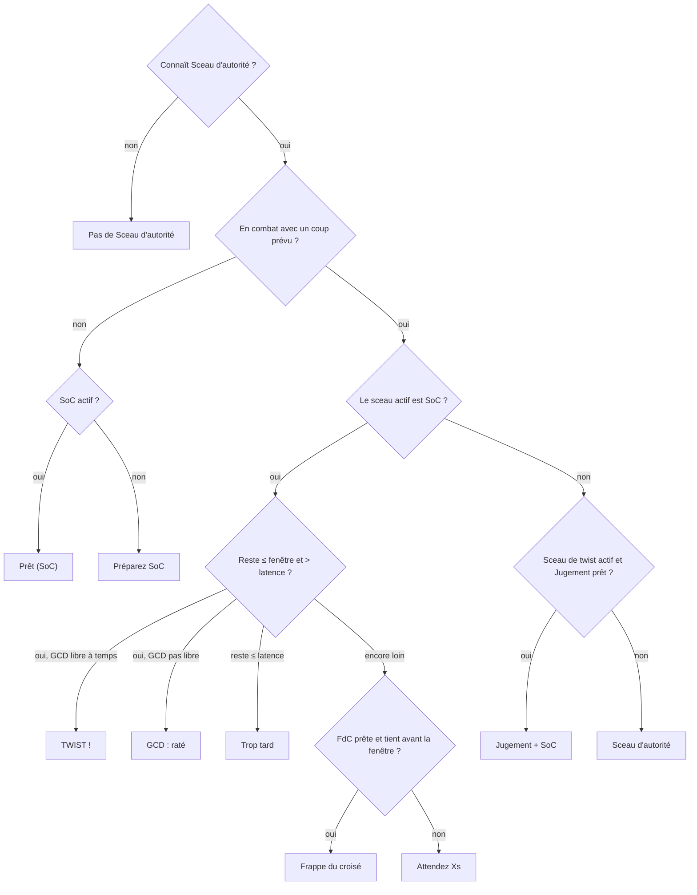
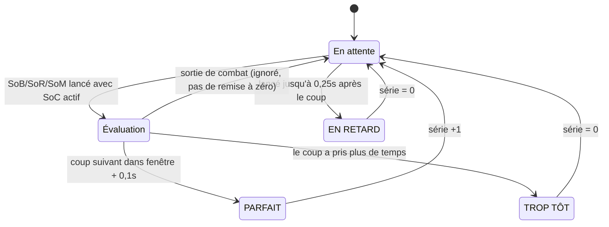

# SilvioSwinger

[English](README.md) · [Português (Brasil)](README.ptBR.md) · [Čeština](README.csCZ.md) · [Deutsch](README.deDE.md) · [Español](README.esES.md) · **Français** · [Русский](README.ruRU.md)

Un indicateur simple de **seal twisting** pour Paladin Vindicte sur le client **2.4.3** (The Burning Crusade).

Il affiche un swing timer avec la fenêtre de twist, indique quel sort lancer maintenant et lequel vient ensuite, mesure les dégâts de chaque twist et compte combien de twists d'affilée vous avez réussis (série).



## Le seal twisting, c'est quoi

Avec le **Sceau d'autorité (SoC)** actif, vous passez à un autre sceau (**Sceau de sang**, **Sceau de piété** ou **Sceau du martyr**) dans les ~0,4s qui précèdent le coup. Le coup qui tombe juste après déclenche **les deux sceaux**. Ensuite vous lancez Jugement (qui ne dépend pas du GCD) et remettez SoC pour le coup suivant.



## Installation

1. Téléchargez `SilvioSwinger-X.Y.Z.zip` depuis la [dernière version](https://github.com/SilvioDoMine/Silvio-Swinger-WoW-Addon/releases/latest) et décompressez-le dans `World of Warcraft/Interface/AddOns/`. Il contient déjà le dossier `SilvioSwinger`.
2. Connectez-vous avec un Paladin. Sur les autres classes, l'addon se masque tout seul.
3. Pour déplacer la fenêtre, maintenez **Maj** et faites glisser.

## La fenêtre

```
 [icône maintenant] [suivant]  TWIST !
                               MANA FAIBLE  lat 85ms
 [████████████████░░░░░░░|░░░░░░░░░░▓▓▓▓█]  1.23 / 3.50
 Série 4 (meilleure 9)  moy. 2310             PARFAIT
```

| Élément | Signification |
|---|---|
| Grande icône | Ce qu'il faut lancer **maintenant** (brille quand c'est le moment) |
| Petite icône | Ce qui vient **ensuite** |
| Texte | Consigne : `Préparez SoC`, Frappe du croisé, `Attendez 1.2s`, `TWIST !`, `Jugement + SoC`, `GCD : raté`, `Trop tard` |
| `lat` | Latence actuelle + marge. `MANA FAIBLE` apparaît sous le seuil configuré |
| Barre grise | Temps avant le prochain coup (restant / vitesse de l'arme) |
| Ligne jaune | Dernier moment pour utiliser le GCD (SoC/FdC) sans perdre le twist |
| Zone verte | Fenêtre de twist : changez de sceau ici |
| Zone rouge | Latence : un sceau lancé ici arrive après le coup |
| Série / résultat | Voir [Série](#série) |

Si l'arme est trop rapide pour caser SoC + twist dans le même coup, la ligne jaune disparaît.

## Comment il choisit quoi recommander



Le sceau de twist est choisi dans le grimoire dans cet ordre : Sceau de sang, Sceau du martyr et Sceau de piété. Tous les noms viennent de l'ID du sort, l'addon fonctionne donc dans toutes les langues du client.

Les changements de hâte (Furie sanguinaire, Tambours, Potion de hâte) recalculent le coup en cours. Les sorts avec temps d'incantation (Exorcisme, Éclair lumineux) relancent le minuteur. Les attaques supplémentaires (Furie-des-vents, Main de justice) non.

## Série

La série compte combien de **twists bien synchronisés** vous avez enchaînés.



- Il n'y a tentative que si le sceau de twist est lancé avec SoC actif dans les 0,3 dernières secondes.
- Les coups sans tentative ne cassent pas la série.
- Changer de cible ou sortir de combat ne remet pas la série à zéro.
- Un coup raté (raté/esquive) compte aussi comme un coup.
- `série` et `meilleure` **ne sont pas sauvegardées**. Elles repartent à zéro avec `/reload`, à la déconnexion, avec `/silvio reset` ou avec le bouton du panneau.

## Dégâts du twist

Tout ce qui tombe avec le coup en moins de 0,4s (coup blanc, attaques supplémentaires et déclenchements de sceau) va dans un même « paquet ». Si deux sceaux se sont déclenchés ensemble, ou si le twist était bien synchronisé, le total s'affiche en haut de l'écran :

```
DÉGÂTS DU TWIST : 3770  =  coup 1320 (1) + Windfury Attack 600 (1) + SoC 1380 (2) + SoB 470 (1)
```

Le nombre entre parenthèses indique combien de coups ou de déclenchements de chacun sont tombés. Les attaques supplémentaires (Rétribution, Totem Furie-des-vents, Main de justice...) apparaissent à part, avec le nom que leur donne votre client. Il est ainsi facile de voir quand quelque chose est désynchronisé : si `SoB` manque, le changement de sceau est arrivé après le coup. `SoB (2)` avec un seul coup est normal : le déclenchement du Sceau d'autorité peut aussi déclencher le Sceau de sang, donc un bon twist donne souvent un SoB de plus. Utilisez `/silvio debug` pour voir chaque événement et comment il a été compté.

Les dégâts que le Sceau de sang vous inflige à vous-même sont ignorés.

## Commandes

`/silvio` ou `/ss`

| Commande | Effet |
|---|---|
| `/silvio` | Affiche l'état actuel et la liste des commandes |
| `/silvio config` | Ouvre le panneau (Échap > Interface > AddOns > SilvioSwinger) |
| `/silvio lock` / `unlock` | Verrouille ou déverrouille la position |
| `/silvio window <s>` | Taille de la fenêtre de twist |
| `/silvio buffer <s>` | Marge supplémentaire ajoutée à la latence |
| `/silvio cs <s>` | Marge nécessaire pour caser une Frappe du croisé |
| `/silvio scale <n>` | Taille de la fenêtre |
| `/silvio judge` | Active/désactive la suggestion de Jugement |
| `/silvio sound` | Active/désactive le son à l'ouverture de la fenêtre (joue un aperçu à l'activation) |
| `/silvio msg` | Active/désactive `DÉGÂTS DU TWIST` en haut |
| `/silvio detail` | Active/désactive le détail des dégâts |
| `/silvio dmg` | Affiche les statistiques de dégâts |
| `/silvio dmgreset` | Remet à zéro les statistiques de dégâts |
| `/silvio show` / `hide` | Affiche ou masque la fenêtre (la logique continue de tourner) |
| `/silvio lang <code>` | Change la langue (`auto`, `enUS`, `frFR`, `ptBR`...) |
| `/silvio debug` | Mode diagnostic : affiche dans le chat chaque événement du journal de combat du twist et comment il a été compté (jusqu'au `/reload`) |
| `/silvio reset` | Remet la série à zéro et replace la fenêtre |

## Réglages

Sauvegardés dans `SilvioSwingerDB`.

| Option | Défaut | Description |
|---|---|---|
| `window` | 0,40s | Combien de temps avant le coup le twist fonctionne encore |
| `buffer` | 0,05s | Marge ajoutée à la latence |
| `csSlack` | 0,10s | Marge pour caser une Frappe du croisé avant la fenêtre |
| `judge` | activé | Suggérer Jugement après le twist |
| `sound` | activé | Ping de la minicarte à l'ouverture de la fenêtre de twist, une fois par coup |
| `lowMana` | 10% | Seuil de l'alerte de mana faible |
| `dmgMsg` | activé | Message `DÉGÂTS DU TWIST` |
| `breakdown` | activé | Détailler coup + sceaux dans le message |
| `scale` | 1,0 | Taille de la fenêtre |
| `locale` | `auto` | Langue de l'interface (`auto` = langue du client) |

## Langues

Par défaut l'addon utilise la langue du client (`GetLocale()`). Pour la changer, utilisez le menu **Langue** du panneau ou `/silvio lang <code>`. Le changement s'applique tout de suite, sans `/reload`.

| Code | Langue | Remarque |
|---|---|---|
| `enUS` | English | Langue de base. Aussi utilisée par le client `enGB` et par tout client sans traduction |
| `ptBR` | Português (Brasil) | Il n'existe pas de client ptBR 2.4.3 : activez-la dans le panneau |
| `csCZ` | Čeština | Il n'existe pas de client csCZ 2.4.3 : activez-la dans le panneau |
| `deDE` | Deutsch | |
| `esES` | Español | Aussi utilisée par le client `esMX` |
| `frFR` | Français | |
| `ruRU` | Русский | Sur un client non russe, la police par défaut n'a pas le cyrillique et le texte peut disparaître |

Les noms de sorts (Frappe du croisé, Sceau d'autorité...) viennent toujours du client, car ils sont lus par ID de sort.

Si une lettre s'affiche comme un carré ou disparaît (par exemple le `ř` ou le `ě` tchèque), la police du client n'a pas ce caractère.

### Ajouter une langue

1. Copiez `Locales/enUS.lua` vers `Locales/<code>.lua` (ex. `plPL.lua`).
2. Remplacez `SilvioSwingerLocales.enUS` par `SilvioSwingerLocales.<code>`, ajustez `_name` et traduisez les textes. Gardez `%d`, `%s` et `%.1f` dans le même ordre.
3. Ajoutez `Locales\<code>.lua` dans `SilvioSwinger.toc`, avant `SilvioSwinger.lua`.
4. Si vous le souhaitez, créez un `README.<code>.md` et ajoutez son lien dans la barre des langues en haut de tous les README.

Un texte absent de la traduction s'affiche en anglais.
