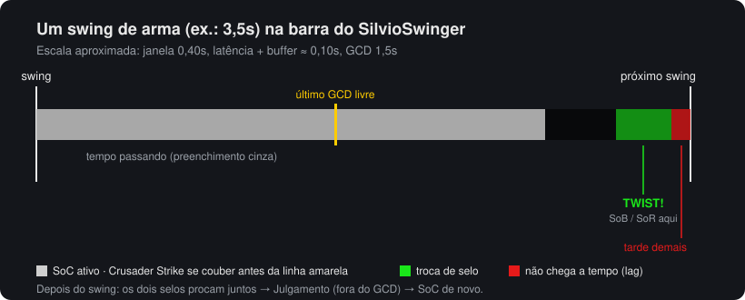
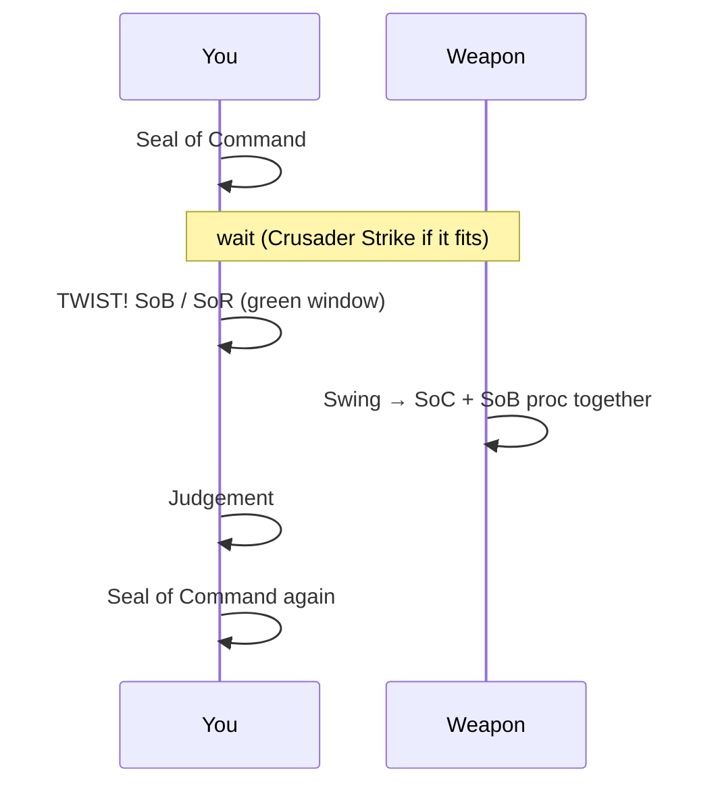
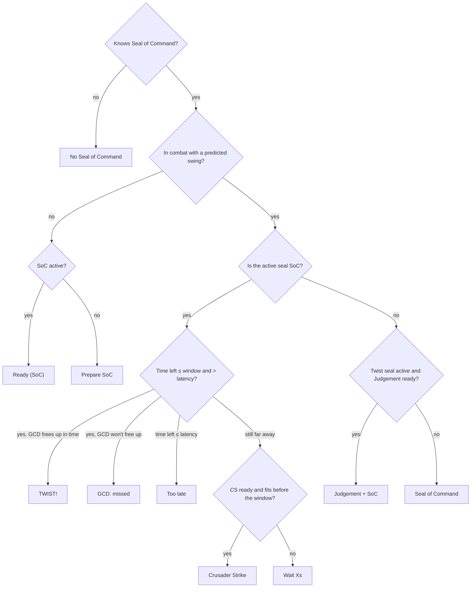
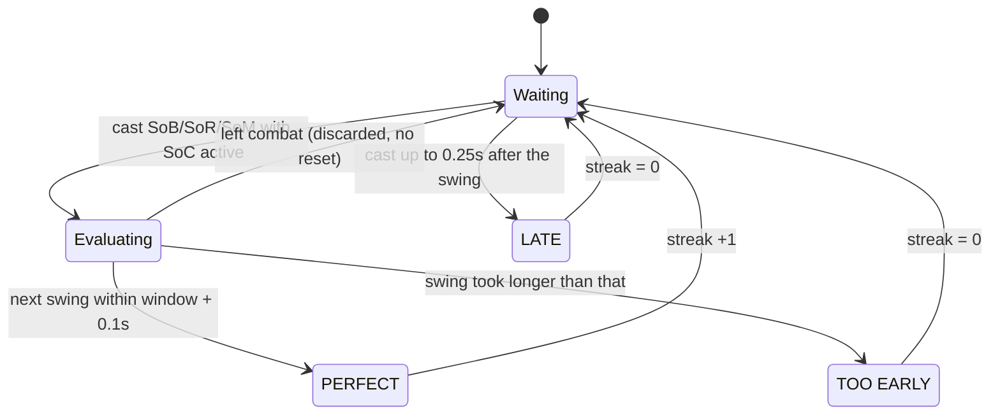

# SilvioSwinger

**English** · [Português (Brasil)](README.ptBR.md) · [Čeština](README.csCZ.md) · [Deutsch](README.deDE.md) · [Español](README.esES.md) · [Français](README.frFR.md) · [Русский](README.ruRU.md)

A simple **seal twisting** helper for Retribution Paladins on the **2.4.3** client (The Burning Crusade).

It shows a swing timer with the twist window, tells you which spell to press now and which one comes next, measures the damage of each twist and counts how many twists in a row you landed (streak).



## What seal twisting is

With **Seal of Command (SoC)** active, you switch to another seal (**Seal of Blood**, **Seal of Righteousness** or **Seal of the Martyr**) in the last ~0.4s before the swing. The swing that lands right after triggers **both seals**. Then you use Judgement (which doesn't depend on the GCD) and put SoC back up for the next swing.



## Installation

1. Copy the `SilvioSwinger` folder to `World of Warcraft/Interface/AddOns/`.
2. Log in with a Paladin. On other classes the addon hides itself.
3. To move the window, hold **Shift** and drag.

## The window

```
 [icon now] [next]  TWIST!
                    LOW MANA  lat 85ms
 [████████████████░░░░░░░|░░░░░░░░░░▓▓▓▓█]  1.23 / 3.50
 Streak 4 (best 9)  avg 2310                  PERFECT
```

| Element | Meaning |
|---|---|
| Large icon | What to press **now** (glows when it's time) |
| Small icon | What comes **next** |
| Text | Instruction: `Prepare SoC`, `Crusader Strike`, `Wait 1.2s`, `TWIST!`, `Judgement + SoC`, `GCD: missed`, `Too late` |
| `lat` | Current latency + buffer. `LOW MANA` shows up below the configured threshold |
| Grey bar | Time until the next swing (remaining / weapon speed) |
| Yellow line | Last moment to use the GCD (SoC/CS) without losing the twist |
| Green zone | Twist window: swap the seal here |
| Red zone | Latency: a seal used here lands after the swing |
| Streak / result | See [Streak](#streak) |

If the weapon is too fast to fit SoC + twist in the same swing, the yellow line disappears.

## How it decides what to recommend



The twist seal is picked from the spellbook in this order: Seal of Blood, Seal of the Martyr and Seal of Righteousness. All spell names come from the spell ID, so the addon works with any client language.

Haste changes (Bloodlust, Drums, Haste Potion) rescale the swing in progress. Spells with a cast time (Exorcism, Flash of Light) restart the timer. Extra attacks (Windfury, Hand of Justice) don't.

## Streak

The streak counts how many **correctly timed twists** you made in a row.



- An attempt only exists when the twist seal is used with SoC active in the last 0.3s.
- Swings without an attempt don't break the streak.
- Switching targets or leaving combat doesn't reset the streak.
- A swing that misses (miss/dodge) still counts as a swing.
- `streak` and `best` **are not saved**. They reset on `/reload`, on logout, with `/silvio reset` or with the panel button.

## Twist damage

Everything that lands with the swing within 0.4s (white hit, extra attacks and seal procs) goes into the same "bundle". If two seals procced together, or if the twist was timed correctly, the total shows up at the top of the screen:

```
TWIST DAMAGE: 2480  (hit 1320 + SoC 690 + SoB 470)
```

Damage that Seal of Blood deals to yourself is ignored.

## Commands

`/silvio` or `/ss`

| Command | Effect |
|---|---|
| `/silvio` | Shows the current state and the command list |
| `/silvio config` | Opens the panel (ESC > Interface > AddOns > SilvioSwinger) |
| `/silvio lock` / `unlock` | Locks or unlocks the position |
| `/silvio window <s>` | Size of the twist window |
| `/silvio buffer <s>` | Extra margin added to latency |
| `/silvio cs <s>` | Slack required to fit a Crusader Strike |
| `/silvio scale <n>` | Window scale |
| `/silvio judge` | Toggles the Judgement suggestion |
| `/silvio sound` | Toggles the sound when the window opens (plays a preview when turned on) |
| `/silvio msg` | Toggles `TWIST DAMAGE` at the top |
| `/silvio detail` | Toggles the damage breakdown |
| `/silvio dmg` | Shows damage statistics |
| `/silvio dmgreset` | Resets damage statistics |
| `/silvio show` / `hide` | Shows or hides the window (the logic keeps running) |
| `/silvio lang <code>` | Changes the language (`auto`, `enUS`, `ptBR`, `csCZ`...) |
| `/silvio reset` | Resets the streak and repositions the window |

## Settings

Saved in `SilvioSwingerDB`.

| Option | Default | Description |
|---|---|---|
| `window` | 0.40s | How long before the swing the twist still works |
| `buffer` | 0.05s | Margin added to latency |
| `csSlack` | 0.10s | Slack to fit a Crusader Strike before the window |
| `judge` | on | Suggest Judgement after the twist |
| `sound` | on | Minimap ping when the twist window opens, once per swing |
| `lowMana` | 10% | Low mana warning threshold |
| `dmgMsg` | on | `TWIST DAMAGE` message |
| `breakdown` | on | Break down hit + seals in the message |
| `scale` | 1.0 | Window scale |
| `locale` | `auto` | Interface language (`auto` = client language) |

## Languages

By default the addon uses the client language (`GetLocale()`). To change it, use the **Language** menu in the panel or `/silvio lang <code>`. The change applies immediately, no `/reload` needed.

| Code | Language | Note |
|---|---|---|
| `enUS` | English | Base language. Also used by the `enGB` client and by any client without a translation |
| `ptBR` | Português (Brasil) | There is no ptBR 2.4.3 client: enable it in the panel |
| `csCZ` | Čeština | There is no csCZ 2.4.3 client: enable it in the panel |
| `deDE` | Deutsch | |
| `esES` | Español | Also used by the `esMX` client |
| `frFR` | Français | |
| `ruRU` | Русский | On a non-Russian client, the default font has no Cyrillic and the text may disappear |

Spell names (Crusader Strike, Seal of Command...) still come from the client, because they are read by spell ID.

If a letter shows up as a box or disappears (for example Czech `ř` or `ě`), the client font doesn't have that character.

### Adding a language

1. Copy `Locales/enUS.lua` to `Locales/<code>.lua` (e.g. `plPL.lua`).
2. Replace `SilvioSwingerLocales.enUS` with `SilvioSwingerLocales.<code>`, adjust `_name` and translate the texts. Keep the `%d`, `%s` and `%.1f` in the same order.
3. Add `Locales\<code>.lua` to `SilvioSwinger.toc`, before `SilvioSwinger.lua`.
4. Optionally, add a `README.<code>.md` and link it in the language bar at the top of every README.

Any text missing from a translation shows up in English.
