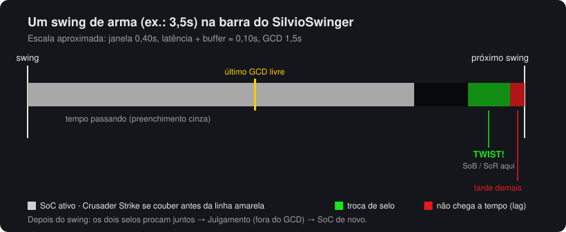
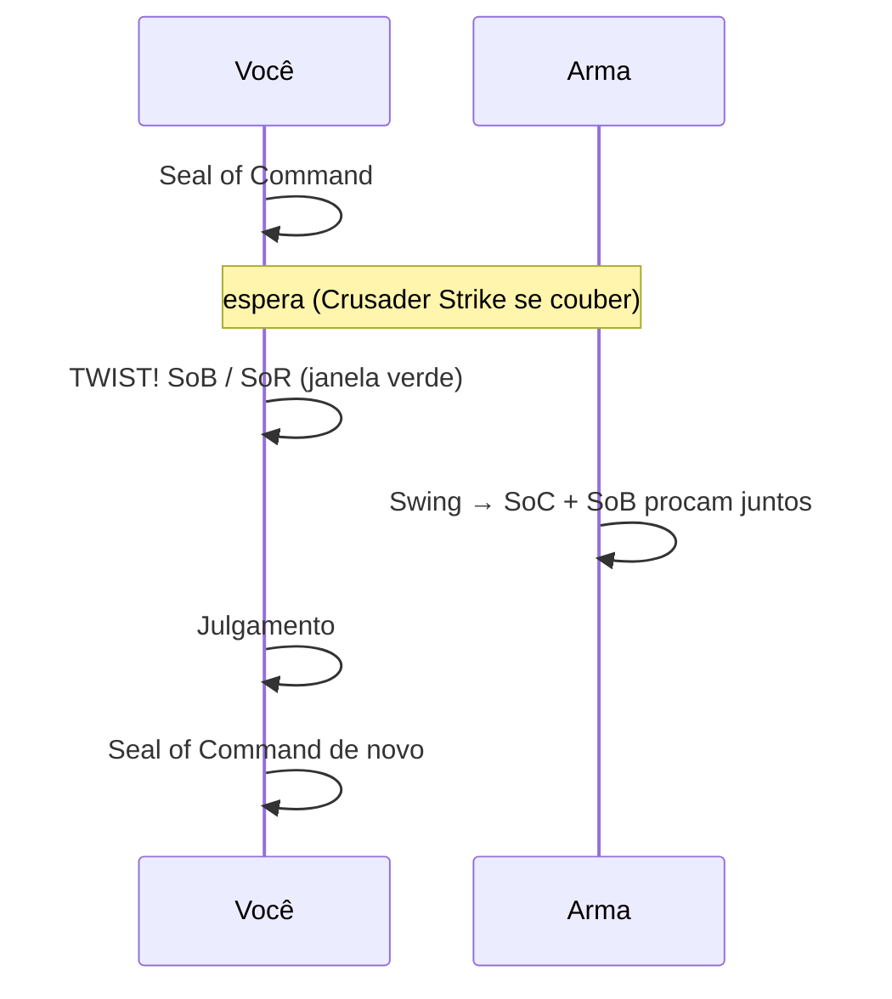
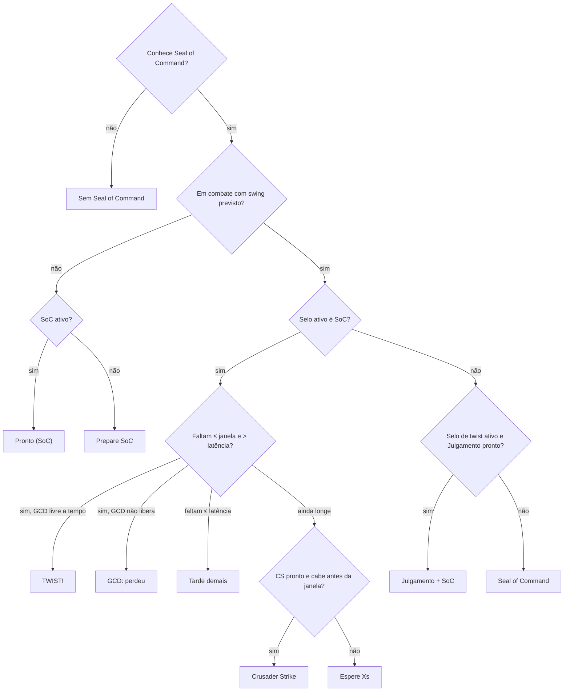
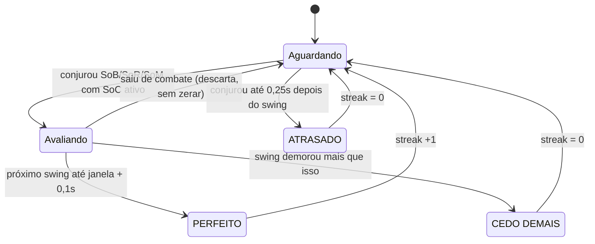

# SilvioSwinger

[English](README.md) · **Português (Brasil)** · [Čeština](README.csCZ.md) · [Deutsch](README.deDE.md) · [Español](README.esES.md) · [Français](README.frFR.md) · [Русский](README.ruRU.md)

Indicador simples de **seal twisting** para Paladino Retribution no cliente **2.4.3** (The Burning Crusade).

Ele mostra um swing timer com a janela de twist, diz qual magia apertar agora e qual vem depois, mede o dano de cada twist e conta quantos twists seguidos você acertou (streak).



## O que é seal twisting

Com o **Seal of Command (SoC)** ativo, você troca para outro selo (**Seal of Blood**, **Seal of Righteousness** ou **Seal of the Martyr**) nos últimos ~0,4s antes do swing. O swing que cai logo depois aciona **os dois selos**. Em seguida você usa Julgamento (que não depende do GCD) e coloca o SoC de novo para o próximo swing.



## Instalação

1. Baixe o `SilvioSwinger-X.Y.Z.zip` da [última release](https://github.com/SilvioDoMine/Silvio-Swinger-WoW-Addon/releases/latest) e extraia em `World of Warcraft/Interface/AddOns/`. Ele já vem com a pasta `SilvioSwinger`.
2. Entre no jogo com um Paladino. Em outras classes o addon se esconde sozinho.
3. Para mover a janela, segure **Shift** e arraste.
4. Para ver o addon em português, escolha **Português (Brasil)** no menu **Idioma** do painel ou use `/silvio lang ptBR`. Não existe cliente 2.4.3 em português, então o padrão é inglês.

## A janela

```
 [ícone agora] [próximo]  TWIST!
                          MANA BAIXA  lat 85ms
 [████████████████░░░░░░░|░░░░░░░░░░▓▓▓▓█]  1.23 / 3.50
 Streak 4 (melhor 9)  média 2310              PERFEITO
```

| Elemento | Significado |
|---|---|
| Ícone grande | O que apertar **agora** (brilha quando é hora) |
| Ícone pequeno | O que vem **depois** |
| Texto | Instrução: `Prepare SoC`, `Crusader Strike`, `Espere 1.2s`, `TWIST!`, `Julgamento + SoC`, `GCD: perdeu`, `Tarde demais` |
| `lat` | Latência atual + buffer. Aparece `MANA BAIXA` abaixo do limite configurado |
| Barra cinza | Tempo até o próximo swing (restante / velocidade da arma) |
| Linha amarela | Último momento para usar o GCD (SoC/CS) sem perder o twist |
| Zona verde | Janela de twist: troque o selo aqui |
| Zona vermelha | Latência: um selo usado aqui chega depois do swing |
| Streak / resultado | Ver [Streak](#streak) |

Se a arma for rápida demais para caber SoC + twist no mesmo swing, a linha amarela some.

## Como ele decide o que recomendar



O selo de twist é escolhido pelo grimório, nesta ordem: Seal of Blood, Seal of the Martyr e Seal of Righteousness. Todos os nomes vêm do spell ID, então o addon funciona em qualquer idioma do cliente.

Mudanças de haste (Bloodlust, Drums, Haste Potion) reescalam o swing em andamento. Magias com tempo de cast (Exorcism, Flash of Light) reiniciam o timer. Ataques extras (Windfury, Hand of Justice) não reiniciam.

## Streak

O streak conta quantos **twists com timing certo** você fez em sequência.



- Só existe tentativa quando o selo de twist é usado com o SoC ativo nos últimos 0,3s.
- Swings sem tentativa não quebram o streak.
- Trocar de alvo ou sair de combate não zera o streak.
- Um swing que erra (miss/dodge) também conta como swing.
- `streak` e `melhor` **não são salvos**. Eles zeram em `/reload`, no logout, com `/silvio reset` ou com o botão do painel.

## Dano do twist

Tudo que cai junto com o swing em até 0,4s (hit branco, ataques extras e procs de selo) entra num mesmo "pacote". Se dois selos procaram juntos, ou se o twist foi feito no tempo certo, o total aparece no topo da tela:

```
DANO DO TWIST: 3770  =  hit 1320 (1) + Windfury Attack 600 (1) + SoC 1380 (2) + SoB 470 (1)
```

O número entre parênteses é quantos golpes ou procs de cada um caíram. Ataques extras (Reckoning, Windfury Totem, Hand of Justice...) aparecem separados, com o nome que o seu cliente dá a eles. Assim fica fácil ver quando algo está dessincronizado: se o `SoB` não aparece, a troca de selo chegou depois do swing. `SoB (2)` com um hit só é normal: o proc do Seal of Command também pode acionar o Seal of Blood, então um bom twist muitas vezes rende um SoB a mais. Use `/silvio debug` para ver cada evento e como ele foi contado.

O dano que o Seal of Blood causa em você mesmo é ignorado.

## Comandos

`/silvio` ou `/ss`

| Comando | Efeito |
|---|---|
| `/silvio` | Mostra o estado atual e a lista de comandos |
| `/silvio config` | Abre o painel (ESC > Interface > AddOns > SilvioSwinger) |
| `/silvio lock` / `unlock` | Trava ou destrava a posição |
| `/silvio window <s>` | Tamanho da janela de twist |
| `/silvio buffer <s>` | Margem extra somada à latência |
| `/silvio cs <s>` | Folga exigida para encaixar Crusader Strike |
| `/silvio scale <n>` | Escala da janela |
| `/silvio judge` | Liga/desliga a sugestão de Julgamento |
| `/silvio sound` | Liga/desliga o som quando a janela abre (ao ligar, toca uma prévia) |
| `/silvio msg` | Liga/desliga `DANO DO TWIST` no topo |
| `/silvio detail` | Liga/desliga o detalhamento do dano |
| `/silvio dmg` | Mostra as estatísticas de dano |
| `/silvio dmgreset` | Zera as estatísticas de dano |
| `/silvio show` / `hide` | Mostra ou esconde a janela (a lógica continua rodando) |
| `/silvio lang <código>` | Troca o idioma (`auto`, `enUS`, `ptBR`, `csCZ`...) |
| `/silvio debug` | Modo diagnóstico: escreve no chat cada evento do combat log do twist e como ele foi contado (até o `/reload`) |
| `/silvio reset` | Zera o streak e reposiciona a janela |

## Configurações

Salvas em `SilvioSwingerDB`.

| Opção | Padrão | Descrição |
|---|---|---|
| `window` | 0,40s | Quanto antes do swing o twist ainda funciona |
| `buffer` | 0,05s | Margem somada à latência |
| `csSlack` | 0,10s | Folga para encaixar um Crusader Strike antes da janela |
| `judge` | ligado | Sugerir Julgamento depois do twist |
| `sound` | ligado | Ping do minimapa quando a janela de twist abre, uma vez por swing |
| `lowMana` | 10% | Limite do aviso de mana baixa |
| `dmgMsg` | ligado | Mensagem `DANO DO TWIST` |
| `breakdown` | ligado | Detalhar hit + selos na mensagem |
| `scale` | 1,0 | Escala da janela |
| `locale` | `auto` | Idioma da interface (`auto` = idioma do cliente) |

## Idiomas

Por padrão o addon usa o idioma do cliente (`GetLocale()`). Para trocar, use o menu **Idioma** no painel ou `/silvio lang <código>`. A troca vale na hora, sem `/reload`.

| Código | Idioma | Observação |
|---|---|---|
| `enUS` | English | Idioma base. Também usado pelo cliente `enGB` e por qualquer cliente sem tradução |
| `ptBR` | Português (Brasil) | Não existe cliente ptBR do 2.4.3: ative pelo painel |
| `csCZ` | Čeština | Não existe cliente csCZ do 2.4.3: ative pelo painel |
| `deDE` | Deutsch | |
| `esES` | Español | Também usado pelo cliente `esMX` |
| `frFR` | Français | |
| `ruRU` | Русский | Num cliente que não é russo, a fonte padrão não tem cirílico e o texto pode sumir |

Os nomes das magias (Crusader Strike, Seal of Command...) continuam vindo do cliente, porque são lidos pelo spell ID.

Se alguma letra aparecer como quadrado ou sumir (por exemplo `ř` ou `ě` do tcheco), a fonte do cliente não tem esse caractere.

### Adicionar um idioma

1. Copie `Locales/enUS.lua` para `Locales/<código>.lua` (ex.: `plPL.lua`).
2. Troque `SilvioSwingerLocales.enUS` por `SilvioSwingerLocales.<código>`, ajuste `_name` e traduza os textos. Mantenha os `%d`, `%s` e `%.1f` na mesma ordem.
3. Adicione `Locales\<código>.lua` no `SilvioSwinger.toc`, antes de `SilvioSwinger.lua`.
4. Se quiser, crie um `README.<código>.md` e coloque o link na barra de idiomas no topo de todos os READMEs.

Um texto que faltar na tradução aparece em inglês.
