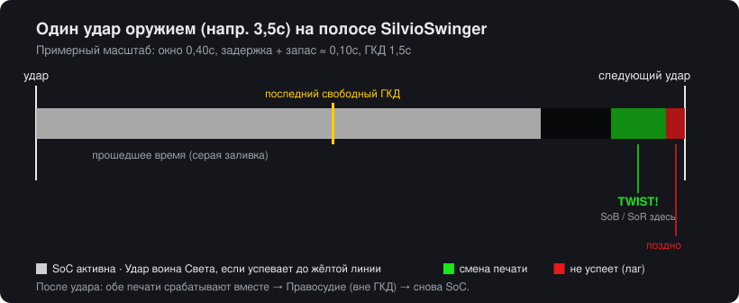
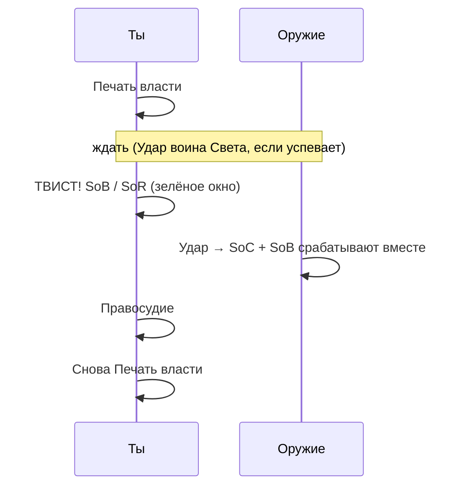
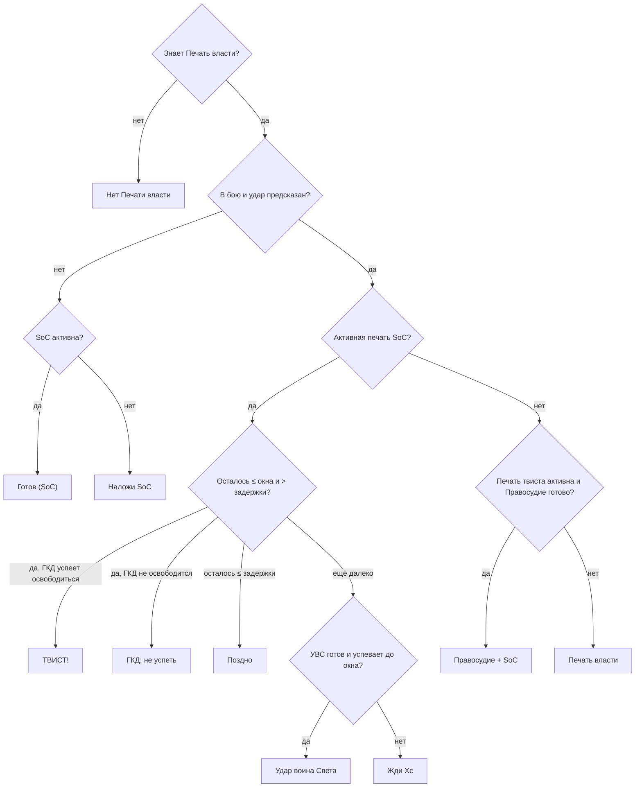
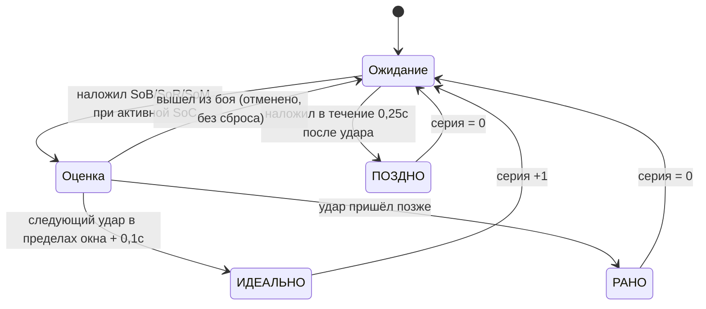

# SilvioSwinger

[English](README.md) · [Português (Brasil)](README.ptBR.md) · [Čeština](README.csCZ.md) · [Deutsch](README.deDE.md) · [Español](README.esES.md) · [Français](README.frFR.md) · **Русский**

Простой помощник для **seal twisting** для паладина «Воздаяние» на клиенте **2.4.3** (The Burning Crusade).

Он показывает таймер удара с окном твиста, подсказывает, какое заклинание нажать сейчас и какое следующим, измеряет урон каждого твиста и считает, сколько твистов подряд у тебя получилось (серия).



## Что такое seal twisting

При активной **Печати власти (SoC)** ты в последние ~0,4с перед ударом переключаешься на другую печать (**Печать крови**, **Печать праведности** или **Печать мученика**). Удар, который приходит сразу после этого, срабатывает с **обеими печатями**. Затем ты используешь Правосудие (не зависит от ГКД) и снова накладываешь SoC на следующий удар.



## Установка

1. Скачай `SilvioSwinger-X.Y.Z.zip` из [последнего релиза](https://github.com/SilvioDoMine/Silvio-Swinger-WoW-Addon/releases/latest) и распакуй в `World of Warcraft/Interface/AddOns/`. Папка `SilvioSwinger` уже внутри.
2. Зайди в игру паладином. На других классах аддон сам скрывается.
3. Чтобы передвинуть окно, зажми **Shift** и перетащи.

## Окно

```
 [значок сейчас] [следующий]  ТВИСТ!
                              МАЛО МАНЫ  пинг 85мс
 [████████████████░░░░░░░|░░░░░░░░░░▓▓▓▓█]  1.23 / 3.50
 Серия 4 (лучшая 9)  ср. 2310                 ИДЕАЛЬНО
```

| Элемент | Значение |
|---|---|
| Большой значок | Что нажать **сейчас** (светится, когда пора) |
| Маленький значок | Что будет **дальше** |
| Текст | Подсказка: `Наложи SoC`, Удар воина Света, `Жди 1.2с`, `ТВИСТ!`, `Правосудие + SoC`, `ГКД: не успеть`, `Поздно` |
| `пинг` | Текущая задержка + запас. Ниже заданного порога появляется `МАЛО МАНЫ` |
| Серая полоса | Время до следующего удара (осталось / скорость оружия) |
| Жёлтая линия | Последний момент для ГКД (SoC/УВС), не теряя твист |
| Зелёная зона | Окно твиста: меняй печать здесь |
| Красная зона | Задержка: печать, наложенная здесь, придёт после удара |
| Серия / результат | См. [Серия](#серия) |

Если оружие слишком быстрое и SoC + твист не помещаются в один удар, жёлтая линия пропадает.

## Как он решает, что подсказать



Печать для твиста выбирается из книги заклинаний в таком порядке: Печать крови, Печать мученика и Печать праведности. Все названия берутся по ID заклинания, поэтому аддон работает на клиенте любого языка.

Изменения скорости (Жажда крови, Барабаны, Зелье ускорения) пересчитывают текущий удар. Заклинания со временем произнесения (Экзорцизм, Вспышка Света) перезапускают таймер. Дополнительные атаки (Неистовство ветра, Рука правосудия) — нет.

## Серия

Серия считает, сколько **правильно выверенных твистов** ты сделал подряд.



- Попытка засчитывается, только если печать твиста наложена, а SoC была активна в последние 0,3с.
- Удары без попытки серию не прерывают.
- Смена цели или выход из боя серию не сбрасывают.
- Удар, который промахнулся (промах/уклонение), тоже считается ударом.
- `серия` и `лучшая` **не сохраняются**. Они сбрасываются при `/reload`, при выходе из игры, командой `/silvio reset` или кнопкой на панели.

## Урон твиста

Всё, что приходит вместе с ударом в пределах 0,4с (белый удар, дополнительные атаки и срабатывания печатей), попадает в один «пакет». Если две печати сработали вместе или твист был выверен правильно, сумма появляется вверху экрана:

```
УРОН ТВИСТА: 3770  =  удар 1320 (1) + Windfury Attack 600 (1) + SoC 1380 (2) + SoB 470 (1)
```

Число в скобках — сколько ударов или срабатываний каждого источника пришлось. Дополнительные атаки (Расплата, Тотем неистовства ветра, Рука правосудия...) показываются отдельно, под тем названием, которое им даёт твой клиент. Так легко заметить рассинхрон: если `SoB` нет, смена печати пришла после удара. `SoB (2)` при одном ударе — это нормально: срабатывание Печати власти тоже может вызвать Печать крови, поэтому удачный твист часто даёт лишний SoB. Через `/silvio debug` видно каждое событие и как оно было учтено.

Урон, который Печать крови наносит тебе самому, не учитывается.

## Команды

`/silvio` или `/ss`

| Команда | Действие |
|---|---|
| `/silvio` | Показывает текущее состояние и список команд |
| `/silvio config` | Открывает панель (ESC > Интерфейс > Модификации > SilvioSwinger) |
| `/silvio lock` / `unlock` | Закрепляет или открепляет позицию |
| `/silvio window <s>` | Размер окна твиста |
| `/silvio buffer <s>` | Дополнительный запас к задержке |
| `/silvio cs <s>` | Запас, нужный для Удара воина Света |
| `/silvio scale <n>` | Масштаб окна |
| `/silvio judge` | Вкл/выкл подсказку Правосудия |
| `/silvio sound` | Вкл/выкл звук при открытии окна (при включении проигрывает пример) |
| `/silvio msg` | Вкл/выкл `УРОН ТВИСТА` вверху |
| `/silvio detail` | Вкл/выкл расшифровку урона |
| `/silvio dmg` | Показывает статистику урона |
| `/silvio dmgreset` | Сбрасывает статистику урона |
| `/silvio show` / `hide` | Показывает или скрывает окно (логика продолжает работать) |
| `/silvio lang <код>` | Меняет язык (`auto`, `enUS`, `ruRU`, `ptBR`...) |
| `/silvio debug` | Режим диагностики: выводит в чат каждое событие журнала боя для твиста и как оно было учтено (до `/reload`) |
| `/silvio reset` | Сбрасывает серию и возвращает окно на место |

## Настройки

Сохраняются в `SilvioSwingerDB`.

| Параметр | По умолчанию | Описание |
|---|---|---|
| `window` | 0,40с | За сколько до удара твист ещё работает |
| `buffer` | 0,05с | Запас, добавляемый к задержке |
| `csSlack` | 0,10с | Запас для Удара воина Света перед окном |
| `judge` | вкл | Предлагать Правосудие после твиста |
| `sound` | вкл | Сигнал миникарты при открытии окна твиста, раз за удар |
| `lowMana` | 10% | Порог предупреждения о мане |
| `dmgMsg` | вкл | Сообщение `УРОН ТВИСТА` |
| `breakdown` | вкл | Расписывать удар + печати в сообщении |
| `scale` | 1,0 | Масштаб окна |
| `locale` | `auto` | Язык интерфейса (`auto` = язык клиента) |

## Языки

По умолчанию аддон использует язык клиента (`GetLocale()`). Чтобы сменить его, используй меню **Язык** на панели или `/silvio lang <код>`. Изменение применяется сразу, без `/reload`.

| Код | Язык | Примечание |
|---|---|---|
| `enUS` | English | Базовый язык. Его же использует клиент `enGB` и любой клиент без перевода |
| `ptBR` | Português (Brasil) | Клиента ptBR для 2.4.3 нет: включается на панели |
| `csCZ` | Čeština | Клиента csCZ для 2.4.3 нет: включается на панели |
| `deDE` | Deutsch | |
| `esES` | Español | Его же использует клиент `esMX` |
| `frFR` | Français | |
| `ruRU` | Русский | На нерусском клиенте в стандартном шрифте нет кириллицы, и текст может пропасть |

Названия заклинаний (Удар воина Света, Печать власти...) по-прежнему берутся из клиента, потому что читаются по ID заклинания.

Если какая-то буква отображается квадратиком или пропадает (например, чешские `ř` или `ě`), в шрифте клиента нет этого символа.

### Добавить язык

1. Скопируй `Locales/enUS.lua` в `Locales/<код>.lua` (например, `plPL.lua`).
2. Замени `SilvioSwingerLocales.enUS` на `SilvioSwingerLocales.<код>`, поправь `_name` и переведи тексты. Сохраняй `%d`, `%s` и `%.1f` в том же порядке.
3. Добавь `Locales\<код>.lua` в `SilvioSwinger.toc` перед `SilvioSwinger.lua`.
4. По желанию создай `README.<код>.md` и добавь ссылку на него в строку языков вверху всех README.

Текст, которого нет в переводе, показывается на английском.
